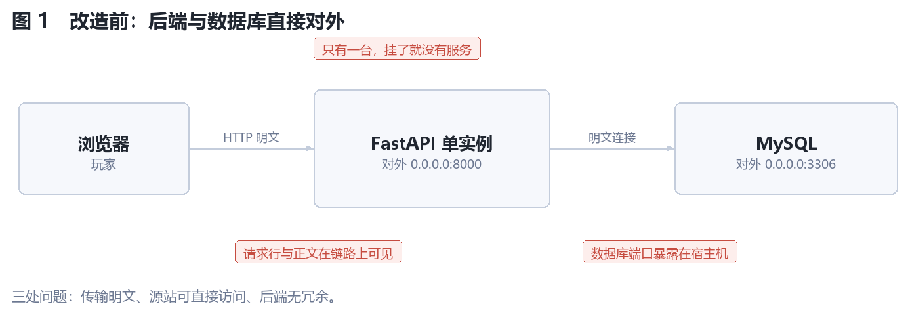
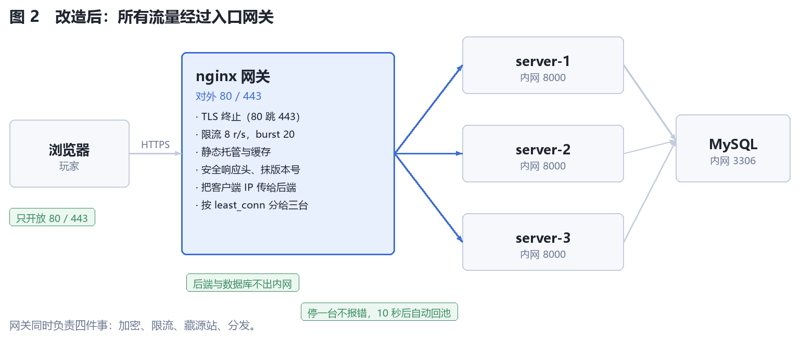

# Web 访问安全中的应用代理与负载均衡

## ——以《共生之缚》Web 入口为例

2 组　2026 年 11 月

## 摘要

《共生之缚》是一款用 Godot 制作的横版动作游戏，除桌面版外还提供 Web 版：玩家用浏览器打开即可游玩，后端用 FastAPI 与 MySQL 承担账号、远程存档、统计埋点与排行榜。这类结构一旦放到公网上，会同时遇到三个问题：内容在链路上明文可见，源站可以被绕过代理直接访问，单台后端一挂服务就断。本文说明应用代理如何解决前两个问题、负载均衡如何解决第三个，并把这两层实际落到本项目中：把原本只做静态托管的 nginx 改造成入口网关，加上 TLS、限流、安全响应头与三副本地址池，最后给出改造前后的实测数据。结论是：本项目的规模还不需要靠负载均衡扩容，但入口这一层已经必须存在，两者要分开判断。

**关键词**：反向代理；TLS 终止；限流；负载均衡；健康检查

## 一、问题从哪来

Web 服务和桌面程序的区别在于，它的入口暴露在网络上，任何人都能发请求。把后端直接开到公网上，会同时出现三个后果。

第一个是明文。HTTP 协议本身不加密，请求行、请求头、请求正文在链路上都是可读的。玩家的登录请求里带着账号和密码，存档请求里带着进度，这些内容经过任何一个中间节点都可能被记录下来。

第二个是源站可被绕过。很多部署会把后端端口直接映射到宿主机，比如 `8000:8000`。这样一来，代理存在与否都无关紧要，攻击者绕开代理打后端，代理上的所有策略就全部失效。数据库端口如果也这样暴露，风险更大。

第三个是单点。只有一台后端时，它重启、升级、或者仅仅是被一个慢请求拖住，服务就中断。

本项目改造前正是这个状态。仓库里的 `deploy/nginx.conf` 只有 22 行：托管 Godot 导出的静态文件，并把 `/api` 转发给唯一的后端 `server:8000`；而 `docker-compose.yml` 把后端 8000 和数据库 3306 都直接映射到了宿主机。也就是说，代理这一层已经存在，但它只承担了"同源转发"这一个功能，安全职责几乎没有，负载均衡则完全没有。



## 二、应用代理在做什么

### 2.1 正向代理与反向代理

两者都是"替别人转发"，区别在替谁办事。

正向代理替客户端办事：客户端配置一个代理地址，请求先到代理，再由代理访问外网。它代表客户端，服务端看到的是代理。

反向代理替服务端办事：客户端以为自己在访问一台服务器，实际上请求先到一个入口，由入口决定交给哪台后端。它代表服务端，客户端不知道后面有几台机器。

安全和负载均衡都落在反向代理这一侧。因为只有入口是唯一的，策略才能统一；只有客户端不知道后端细节，源站才藏得住。

### 2.2 一次请求穿过网关的七步

理解代理的捷径是把一次请求拆开看。以本项目的配置为例，一个 `GET /api/v1/health` 到达网关后经历下面七步。

| 步骤 | 做什么 | 本项目对应的配置 |
|---|---|---|
| 1 接连接 | 接受 TCP 连接，建立 TLS 会话 | `listen 443 ssl`、`ssl_protocols TLSv1.2 TLSv1.3` |
| 2 解析报文 | 解析出方法、路径、Host、请求头 | 七层代理才有这一步，四层代理看不到这些 |
| 3 决定路由 | 按路径或主机名选择处理方式 | `location /` 走静态，`location /api/` 走上游 |
| 4 改写头部 | 补上后端需要的来源信息，删掉不该外传的头 | `X-Real-IP`、`X-Forwarded-For`、`X-Forwarded-Proto` |
| 5 建立上游连接 | 从地址池挑一台后端并连接 | `upstream` + `least_conn` + `keepalive 16` |
| 6 转发与回传 | 边收边转，不等整个响应结束 | 默认流式转发，适合几十 MB 的 `wasm` / `pck` |
| 7 收尾 | 记录耗时、处理超时与断连 | `access_log`、`proxy_read_timeout 30s` |

### 2.3 "成熟"体现在哪几步

写一个能转发的脚本并不难，一百多行就能跑。工业级实现和它的差距集中在第 5、6 步和超时体系上。

第 5 步的关键是连接复用。如果每个请求都重新和后端握手，握手本身的开销会随着并发升高迅速变大，还会在操作系统里留下大量等待关闭的连接。`keepalive 16` 让网关保持一组到后端的长连接，请求直接复用。

第 6 步的关键是流式转发。把响应整体缓冲下来再发送，意味着网关内存要能装下响应体；我们的 Web 版游戏包是几十 MB 的二进制文件，整块缓冲会直接把内存打满。边收边转可以让内存占用与文件大小无关。

超时要分层。连接超时、读超时、写超时分别设置，才能区分"后端连不上"和"后端算得慢"。本项目里 `proxy_connect_timeout 5s`、`proxy_read_timeout 30s`。

此外还有一个容易被忽略的东西：`zone`。地址池如果不共享状态，每个 worker 会各算各的轮询计数，请求量小的时候看起来全打在某一台上。这一点在实测里踩到过，配置注释里也留了记录。

## 三、代理承担的安全职责

下表是本项目网关实际承担的职责，最后一列是实测证据，不是设计意图。

| 职责 | 机制 | 本项目配置 | 实测证据 |
|---|---|---|---|
| 传输加密 | TLS 在网关终止，后端之间走内网明文 | `listen 443 ssl` | 同一段链路，加密前能读到 `GET /api/v1/health` 与完整 JSON，加密后只有十六进制 |
| 藏住源站 | 后端与数据库不映射宿主机端口 | `expose` 而非 `ports` | `docker port` 查后端与数据库，输出为空 |
| 收敛指纹 | 不对外报软件版本 | `server_tokens off` | 响应头从 `server: uvicorn` 变成 `server: nginx` |
| 限流 | 每 IP 每秒 8 个请求，并发 20 | `limit_req`、`limit_conn` | 40 个并发请求中 21 个通过，19 个返回 429 |
| 防大包 | 请求体上限 4 MB | `client_max_body_size` | 超出返回 413 |
| 防慢速连接 | 请求头与请求体超时 15 秒 | `client_header_timeout` | 半开连接被断开 |
| 提供真实来源 | 覆盖并追加转发头 | `X-Real-IP`、`X-Forwarded-For` | 探针 `client_ip` 字段能读到最左一个地址 |
| 减少信息泄漏 | 安全响应头 | `nosniff`、`X-Frame-Options`、`Referrer-Policy` | 三项均出现在响应头中 |

有两处细节值得单独说。

**限流的状态码**。nginx 的 `limit_req` 默认返回 503。503 的语义是"服务不可用"，客户端看到会以为后端坏了，重试策略也会跟着变。真正要表达的是"你请求太多了"，那是 429。所以要显式写 `limit_req_status 429`。第一次实测时出现的是 19 个 503，改成 429 之后才是现在的结果。

**转发头的信任链**。网关看到的是真实客户端地址，所以用 `$binary_remote_addr` 做限流键是准确的。但后端看到的是网关自己的地址，想按用户限流就必须读 `X-Forwarded-For`。这个头可以被伪造，因此只有当它由我们自己的网关覆盖写入时才可信。本项目的做法是在网关里用 `proxy_set_header X-Forwarded-For $proxy_add_x_forwarded_for` 覆盖，后端只取最左一个值。如果以后在前面再加一层 CDN，这里必须改用 realip 模块，否则所有用户会被当成同一个 IP 一起限流。

## 四、负载均衡

### 4.1 它解决的是两个问题

一个是容量：单台后端算不过来，需要横向扩展。另一个是可用性：不能因为一台机器故障就停止服务。

这两件事的门槛完全不同。容量问题需要流量到位才出现，可用性问题跟流量无关——哪怕一天只有三个用户，只要服务不允许中断，就该有第二台。

判断容量是否到顶有可操作的方法：压测画出请求量与延迟的关系曲线，找到曲率突变的拐点，并发长期超过拐点六成左右，就该考虑扩容。凭感觉加机器，往往加在了错的地方。

### 4.2 算法与适用场景

| 算法 | 怎么分 | 适合 | 什么时候失效 |
|---|---|---|---|
| 轮询 | 依次轮流 | 后端同构、请求耗时相近 | 有慢请求时会堆积到某些节点 |
| 加权轮询 | 按权重分 | 机器配置不同 | 权重靠人工估，流量变化后要重调 |
| 最少连接 | 给当前连接最少的一台 | 请求耗时差异大 | 长连接场景下计数失真 |
| IP 哈希 | 按客户端地址取模 | 需要会话保持 | 用户分布不均时会倾斜 |
| 一致性哈希 | 按哈希环分配 | 缓存类、需要节点增减稳定 | 实现复杂，节点少时均衡性一般 |

本项目用的是 `least_conn`。原因是健康检查与探测请求耗时接近，但真实业务里的存档上传、排行榜查询耗时差别很大，最少连接比轮询更抗慢请求。

### 4.3 健康检查：被动与主动

nginx 开源版只有被动检查：某台后端连续失败 `max_fails` 次后，标记为不可用，`fail_timeout` 之后重新放回地址池。本项目配的是 `max_fails=2 fail_timeout=10s`。

被动检查有一个代价，实测里看得很清楚：停掉一台后端后，所有请求仍然成功，但其中一次耗时 5020 ms。原因是那个请求正好打到已经死掉的实例，要等 `proxy_connect_timeout` 到点才重试下一台。

想消除这个等待，要么把连接超时调短（代价是慢后端更容易被误判），要么换有主动探测的实现（NGINX Plus、Envoy 都支持周期性地主动探活）。这是"成熟方案"之间真正的差距之一，不在配置写法上。

### 4.4 会话保持与无状态

如果后端把用户状态放在自己的内存里，负载均衡就必须保证同一个用户始终落到同一台，否则每次换台都要重新登录。粘性会话、IP 哈希都是为此存在的，但它们同时带来了新问题：扩容时老用户不会重新分布，容量利用不均。

本项目的后端是无状态 REST：账号、存档、排行榜都存在 MySQL 里，任何一台后端都能处理任何请求。这是"加副本不用改代码"的前提，也让上面那套粘性会话的问题根本不会出现。设计上省掉这一层，比事后配置要划算。

### 4.5 本项目的判断

结论是：**入口这一层必须存在，负载均衡这一层现在还不需要。**

这个项目的访问量很小，一门课的作品不会有并发压力；后端是无状态 REST，真要扩也只是加副本，不需要改代码；更关键的是，就算扩了，瓶颈也会立刻转移到 MySQL，而不是 uvicorn。

换句话说，现在加副本是给错的地方扩容。真正该先做的是把入口的安全职责补齐——这部分跟流量无关，是"必须有"。

本文做的改造，正是把前者补上，同时把后者预留出来并做了验证：三台后端确实能跑通、能分流、能在故障时绕开。验证的目的是确认这条路可行，不是声称我们现在需要它。

## 五、改造做了什么

### 5.1 前后对照

| 项 | 改造前 | 改造后 |
|---|---|---|
| 对外端口 | 8000（后端）、3306（数据库）、8080（静态） | 80、443 |
| 传输 | 明文 HTTP | 80 跳 443，TLS 1.2 / 1.3 |
| 后端数量 | 1 | 3，`least_conn` 调度 |
| 故障处理 | 无 | `max_fails` 摘除 + 重试下一台 |
| 限流 | 无 | 8 r/s，burst 20，超出 429 |
| 版本指纹 | `server: uvicorn` | `server: nginx` |
| 请求体上限 | 无 | 4 MB |
| 缓存策略 | 无 | 入口页不缓存，带哈希的资源长缓存 |



### 5.2 关键配置

地址池部分：

```nginx
upstream symbiont_backend {
    zone symbiont_backend 64k;
    least_conn;
    server server-1:8000 max_fails=2 fail_timeout=10s;
    server server-2:8000 max_fails=2 fail_timeout=10s;
    server server-3:8000 max_fails=2 fail_timeout=10s;
    keepalive 16;
}
```

限流部分：

```nginx
limit_req_zone  $binary_remote_addr zone=api_limit:10m rate=8r/s;
limit_conn_zone $binary_remote_addr zone=conn_limit:10m;
limit_req_status  429;
limit_conn_status 429;
```

反代部分：

```nginx
location /api/ {
    limit_req  zone=api_limit burst=20 nodelay;
    proxy_pass http://symbiont_backend;
    proxy_http_version 1.1;
    proxy_set_header Connection "";
    proxy_set_header X-Forwarded-For $proxy_add_x_forwarded_for;
    proxy_next_upstream error timeout http_502 http_503 http_504;
}
```

还有一条是对外端口本身：数据库与后端改成 `expose`，不再 `ports`。这一行改动比任何配置都关键——源站只要还能被直连，代理上的策略就都可以绕过。

### 5.3 两个结构性坑

改造过程中遇到两个问题，都和 nginx 语法无关。

第一个是编排文件的命名。两份 compose 文件都放在 `deploy/` 目录下，compose 默认用目录名当项目名，于是两者被视为同一个项目。启动对照编排时，它把网关那套的容器顶掉了。解决办法是在文件里显式写 `name:`。

第二个是本机端口冲突。改造前的编排映射了 8000、3306、8080，这三个端口在本机分别被打印控件、本机 MySQL、Apache 占着，也就是说那份"一键部署"从来没真正起来过。新架构只用 80 和 443，反而绕开了这个问题。

## 六、实测

### 6.1 环境

| 项 | 版本 |
|---|---|
| 操作系统 | Windows 11 |
| Docker | 29.7.2 |
| nginx | 1.31.8（alpine） |
| Python / FastAPI / uvicorn | 3.12.16 / 0.115.14 / 0.30.6 |
| MySQL | 8.4.13 |

### 6.2 结果

| 场景 | 做法 | 结果 |
|---|---|---|
| 分流 | 依次请求 12 次 | node-1、node-2、node-3 各 4 次，成功率 100% |
| 限流 | 40 个请求并发 | 21 个 200，19 个 429，成功率 52% |
| 故障转移 | 停掉 node-2 后请求 9 次 | 9 次全部成功，落到 node-1 与 node-3 |
| 故障代价 | 同上 | 最慢一次 5020 ms |
| 自愈 | 重启 node-2，等 10 秒 | 请求再次均匀落在三台，各 4 次 |
| 明文对照 | 经中继访问明文端口 | 中继打印出完整请求行、请求头与 JSON |
| 密文对照 | 经中继访问 443 | 只能打印 `16 03 01 ...` 等十六进制 |
| 源站隐藏 | `docker port` 查询后端与数据库 | 输出为空 |

### 6.3 读这些数字要注意

限流那一项，"21 个通过"不是巧合：配置是每秒 8 个、突发容量 20 个，所以一瞬间最多放过 21 个请求，其余直接拒绝。这个数可以用来验证配置是否真的生效。

故障转移那一项，成功率 100% 但有一个 5 秒的请求，两个数字都要报。只报成功率会掩盖被动健康检查的代价。

## 七、什么情况下才真的需要负载均衡

把判断标准按台阶写出来，比罗列算法更有用。

| 台阶 | 什么时候该往上走 | 上去会引入什么新问题 |
|---|---|---|
| 单机跑通 | 初始状态 | 无 |
| 单机优化 | 延迟随并发上升，但资源没用满 | 优化有上限，且改动可能影响正确性 |
| 多副本 + 代理 | 单机资源打满，或服务不允许中断 | 会话保持、日志分散、配置一致性 |
| 多代理 + 外层均衡 | 代理本身成了单点 | 多一层转发，链路更难排查 |
| 多机房 | 跨地域延迟不可接受 | 数据同步、一致性、成本 |

本项目现在停在第一级与第二级之间：入口这一层已经按第三级的样子搭好并做了验证，但流量还没到需要它的程度。这个判断需要说清楚，否则容易被理解成"我们上了负载均衡所以很先进"。

## 八、局限与后续

第一，证书是自签的。浏览器首次访问会提示不安全，需要手动确认。这只适合演示与本机验收，正式上线必须换 CA 签发的证书。

第二，证书会影响客户端。桌面版游戏的 `network.gd` 现在指向 `http://127.0.0.1:8000/api/v1`，那是本地开发时用 `run_server.ps1` 起在后端的地址。如果以后要让游戏连网关，地址要改成 `https://localhost/api/v1`，而 Godot 的 HTTPRequest 默认不信任自签证书，需要导入证书或改校验策略。这一条目前没有影响，因为远程存档的 `push_save` 与 `pull_save` 还是空实现。

第三，代理自身是新的单点。现在只有一台网关，它挂了整个服务就断。要消除这一层单点，需要外层再做一次均衡，超出本次范围。

第四，Web 版还没有真正导出。`scripts/export_web.ps1` 目前是空壳，没有 Web 导出预设，所以现在网页里只有落地页与状态页，游戏本体还进不去浏览器。这不影响代理与负载均衡的验证，但它是"Web 访问"这个前提的另一半。

## 九、参考资料

1. RFC 7230, HTTP/1.1: Message Syntax and Routing.
2. RFC 8446, The Transport Layer Security (TLS) Protocol Version 1.3.
3. nginx 官方文档：ngx_http_upstream_module、ngx_http_limit_req_module、ngx_http_proxy_module。
4. NGINX Plus 主动健康检查文档。
5. Envoy Proxy 官方文档：Upstream Health Checking。

## 附录　全部演示命令

```powershell
# 1 生成自签证书（只做一次）
scripts/gen_cert.ps1

# 2 起网关栈（mysql + 三台后端 + 代理）
docker compose -f deploy/docker-compose.yml up -d --build

# 3 起对照栈（裸奔：单后端，端口直接对外）
docker compose -f deploy/docker-compose.baseline.yml up -d --build

# 4 分流：三台各 4 次
python deploy/bench.py --mode seq --n 12

# 5 限流：21 个 200，19 个 429
python deploy/bench.py --n 40 --concurrency 40

# 6 故障转移：9 次全部成功
docker stop symbiont-server-2-1
python deploy/bench.py --mode seq --n 9
docker start symbiont-server-2-1

# 7 明文与密文对照（中继另开终端，发请求走 18181 / 18182）
python deploy/tap.py --listen 18181 --target 18081
python deploy/tap.py --listen 18182 --target 443
```
